# Rayhan Games Catalog

Aplikasi katalog game fullstack: frontend **React (Vite)** dan backend **NestJS** yang menyimpan data secara permanen di **PostgreSQL** menggunakan **Prisma ORM**.

- **Tugas:** Tugas 10
- **Nama:** M. Rayhan Ramadhan Afdhani
- **NIM:** 103022400107

## Deskripsi

Katalog game digital yang menampilkan daftar game (judul, genre, rating, tahun rilis, platform, developer), dengan fitur cari, lihat detail, serta tambah, ubah, dan hapus game langsung dari halaman web. Pada Pekan 9 data masih disimpan di memori; pada Pekan 10 data disimpan di PostgreSQL sehingga tetap ada setelah server di-restart.

## Struktur Proyek

```
.
├── game-api-103022400107/     # Backend NestJS + Prisma + PostgreSQL
│   ├── prisma/                # schema.prisma, migrations, seed
│   └── src/
│       ├── prisma/            # PrismaService & PrismaModule
│       └── games/             # Controller, Service, DTO
├── game-app/                  # Frontend React (Vite)
└── docs/screenshots/          # Screenshot tiap tahapan
```

## Endpoint REST API

| Method | Endpoint | Keterangan |
|---|---|---|
| GET | `/games` | Daftar game (opsional `?genre=` dan `?search=`) |
| GET | `/games/:id` | Detail satu game |
| POST | `/games` | Tambah game |
| PATCH | `/games/:id` | Ubah game |
| DELETE | `/games/:id` | Hapus game |
| GET | `/games/statistik` | Statistik: total game, rata-rata rating dan harga, jumlah per genre |

## Cara Menjalankan

Prasyarat: Node.js dan PostgreSQL lokal.

### 1. Backend

```bash
cd game-api-103022400107
npm install
cp .env.example .env        # lalu isi USER dan PASSWORD PostgreSQL
npx prisma generate
npx prisma migrate dev      # membuat tabel games
npx prisma db seed          # mengisi 6 game awal
npm run start:dev           # http://localhost:3000
```

Database `game_catalog_103022400107` dibuat dulu di PostgreSQL (lewat pgAdmin atau `CREATE DATABASE game_catalog_103022400107;`).

### 2. Frontend

```bash
cd game-app
npm install
npm run dev                 # http://localhost:5173
```

Alamat API dapat diubah lewat variabel `VITE_API_URL` (bawaan `http://localhost:3000`).

## Screenshot

Semua screenshot ada di folder [docs/screenshots](docs/screenshots).

### Tahapan

| Tahap | Screenshot |
|---|---|
| 1. Database PostgreSQL di pgAdmin | 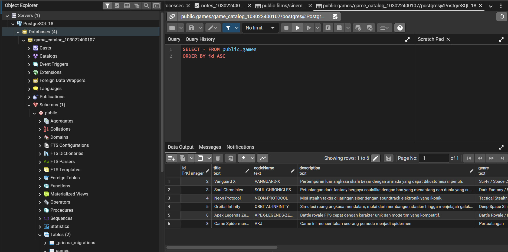 |
| 2. Model Prisma (`schema.prisma`) | 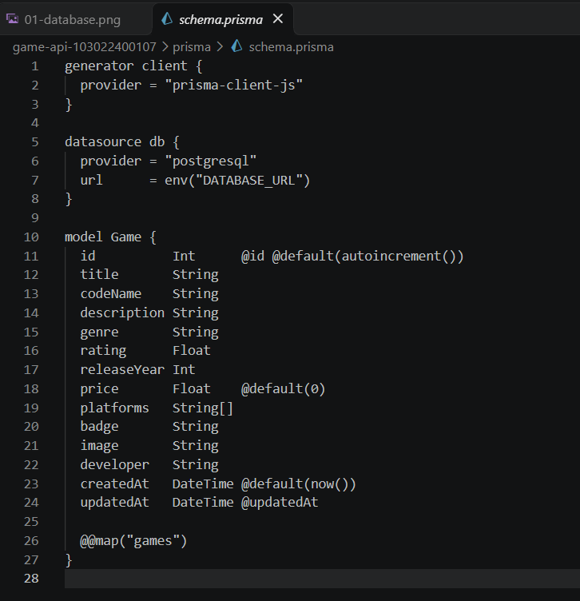 |
| 3. Migrasi dan tabel `games` | 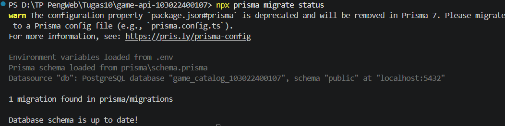 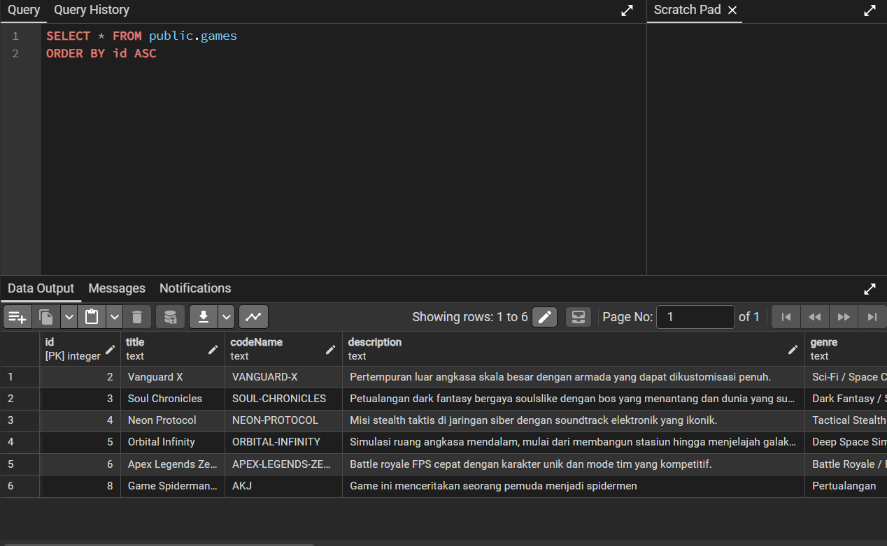 |
| 4. PrismaService dan GamesService | 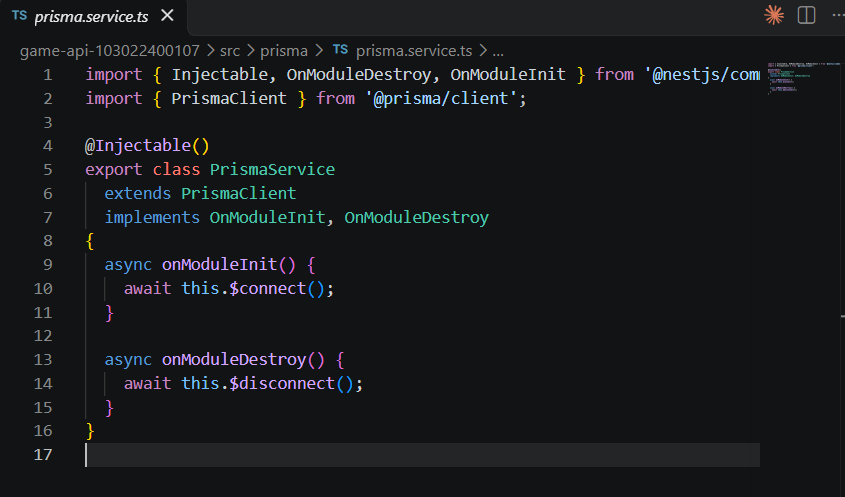 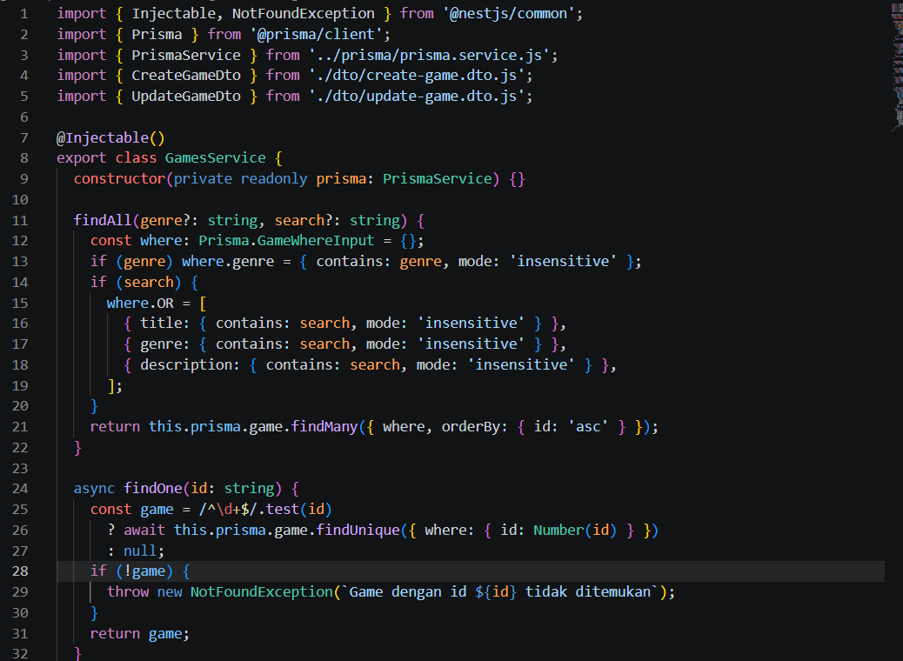 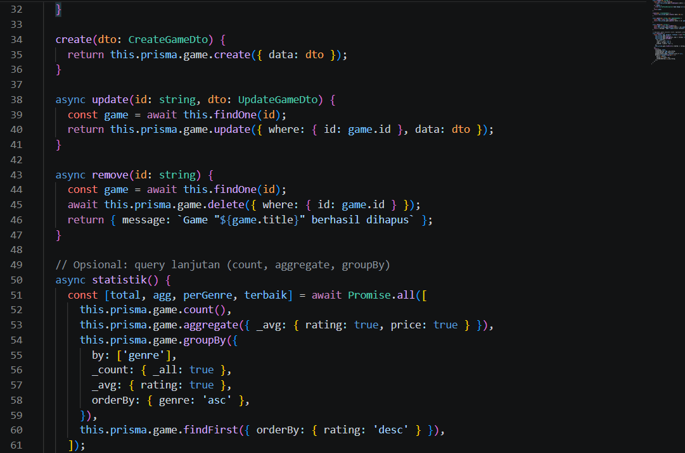 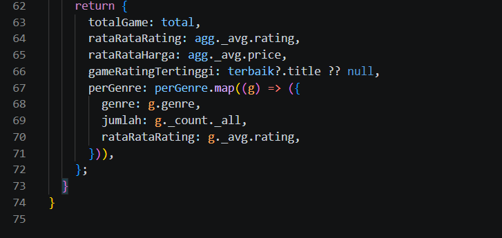 |
| 5. CRUD: Read | 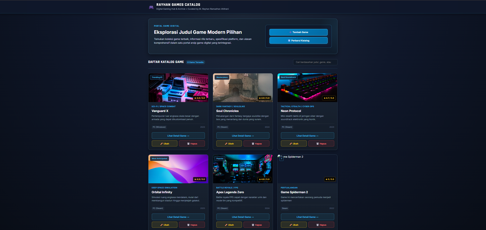 |
| 5. CRUD: Create | 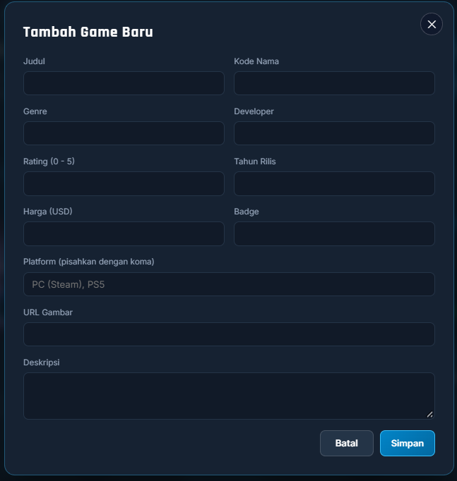 |
| 5. CRUD: Update | 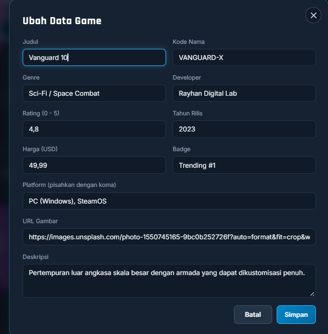 |
| 5. CRUD: Delete | 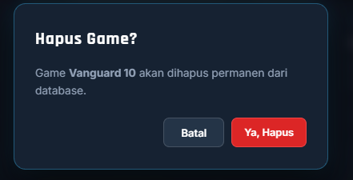 |
| 5. Data tetap ada setelah restart | 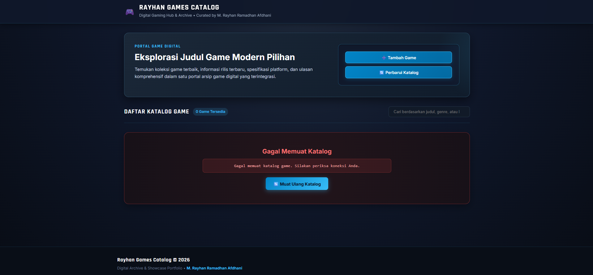  |
| 6. Endpoint statistik | 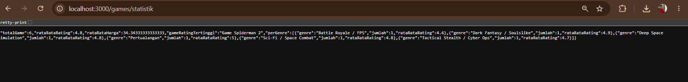 |

### Tampilan Desktop dan Mobile

| Desktop | Mobile |
|---|---|
| 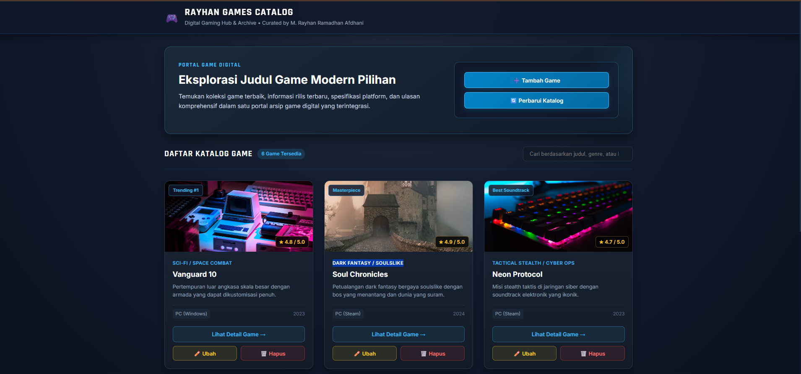 | 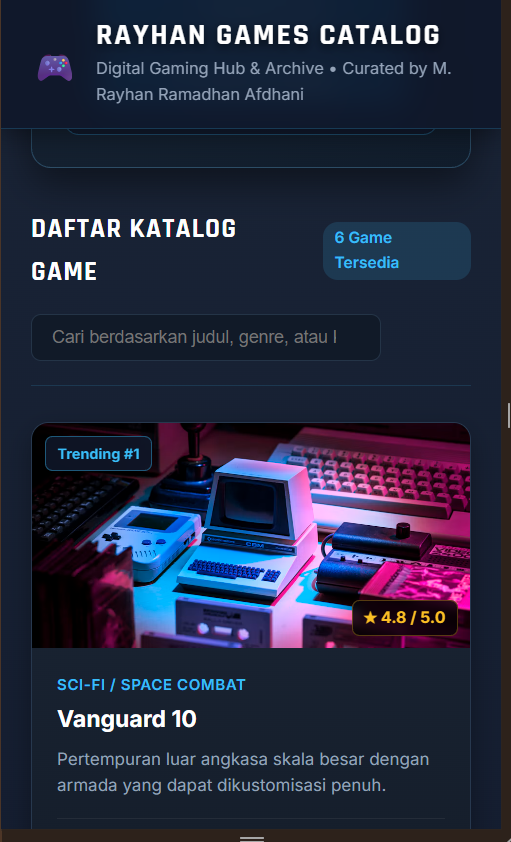 |
